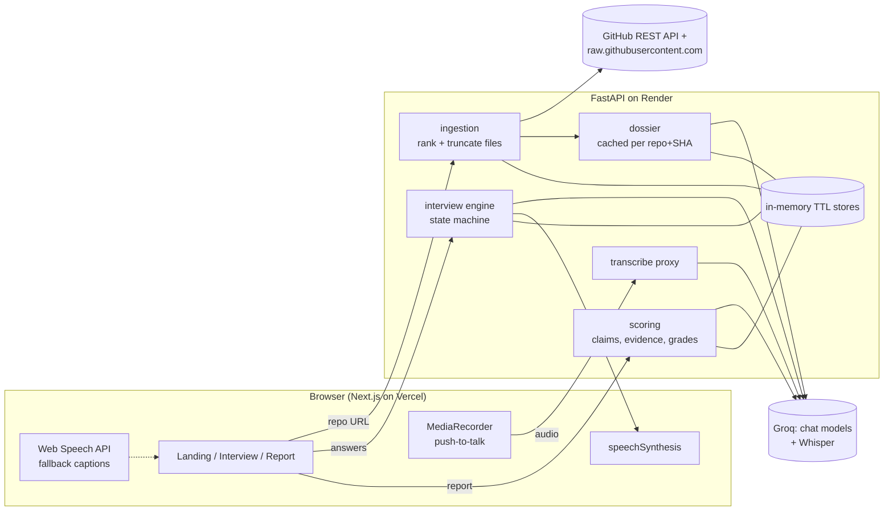

# RepoGrill

**Paste a GitHub repo. Get grilled on it, out loud, by an interviewer who has actually read your code, and see every claim you made that the code doesn't back up.**


<!-- Demo GIF placeholder: record landing -> voice interview -> scorecard and save as docs/demo.gif -->

## Features

- **Reads your repo.** Ranks the files that matter (README, manifests, entrypoints, core source), parses dependencies and builds a *project dossier*: stack, architecture, design decisions, weak spots and 12 tailored questions.
- **Voice interview.** Push-to-talk (button or hold <kbd>Space</kbd>), Whisper transcription you can edit before sending, and an interviewer voice through the browser's speech synthesis. If server transcription fails, the browser's own speech recognition is used instead.
- **Adaptive follow-ups.** After each answer the interviewer rates it (solid, partial, vague, contradicts the code, non-answer). It pushes back on hand-waving with specific files and components, at most twice per topic.
- **Bluff detection.** Every concrete technical claim you make is checked against the repo. The scorecard shows what was verified, what was contradicted, and named technologies that leave no trace, with links to the exact file and line at the analysed commit.
- **Scorecard.** Overall score out of 100, depth, accuracy and clarity grades for each question, strengths, and the top 5 questions to prepare with talking points grounded in your code. You can copy it all as Markdown.
- **Free tier only.** Groq (LLM and Whisper), the GitHub REST API, Render and Vercel free plans, and browser text-to-speech. No database: all state lives in memory with a 2-hour TTL.

## Architecture



**Flow:** `POST /api/ingest` → `GET /api/dossier/{repo_id}` → `POST /api/session` → `POST /api/session/{id}/answer` (repeat) → `GET /api/session/{id}/report`. Audio goes to `POST /api/transcribe`.

### How bluff detection works

1. **Extract.** After the interview, the fast model pulls concrete claims out of each answer as JSON, e.g. `{"claim": "uses Redis for caching", "keywords": ["redis", "cache"], "kind": "technology"}`.
2. **Verify deterministically.** No LLM is involved at this step. The first keyword is looked up in order:
   - declared dependencies from `package.json`, `pyproject.toml`, `requirements*.txt`, `go.mod`, `Cargo.toml`, `Gemfile`, Maven/Gradle, `composer.json`, Dockerfiles and compose files, with aliases (e.g. `postgres` ↔ `psycopg`, `asyncpg`, `pg`)
   - file paths (e.g. `docker` → `Dockerfile`, `github actions` → `.github/workflows/`)
   - a word-bounded search of the fetched source, which records file and line
3. **Label.**
   - `verified`: found in code, config or dependencies (cited).
   - `contradicted`: not found, while a direct alternative *is* present. Claiming Postgres when only SQLite exists, or Kafka when the repo uses RabbitMQ, counts.
   - `unverified`: no evidence either way.
4. **Adjudicate only the ambiguous cases.** When the only mention is in docs, or only secondary keywords match, the LLM sees a few lines of code around each match and decides.
5. **Grade.** Claim results feed into each answer's accuracy grade. Every contradicted claim also costs 5 points off the overall score, capped at 20.

The "Bluffs caught" list contains contradicted claims plus unverified claims about named technologies.

### Staying inside free-tier limits

Groq's free tier caps each model at about 8k tokens per minute, so every call has a budget:

- The dossier prompt is packed into `DOSSIER_INPUT_TOKENS` (default 4,500). Files are ranked, and anything that doesn't fit is reduced to a *skeleton* (imports, signatures, routes).
- Interviewer calls only see the dossier summary, the current question, the last 4 turns and running notes. They never see the full transcript.
- Claim extraction and grading are batched by token budget.
- HTTP 429 and 5xx responses are retried with exponential backoff and jitter (4 attempts, honouring `Retry-After`). If the limit persists, the API returns 429 and the UI shows "Rate limited, retrying…".
- Dossiers are cached per `repo + commit SHA`. File contents come from `raw.githubusercontent.com`, which doesn't count against the GitHub API quota.
- Every LLM output is validated with pydantic. Invalid JSON gets one repair attempt, then fails gracefully.

## Local setup

**Requirements:** Python 3.11+, Node 20+, a free [Groq API key](https://console.groq.com/keys) and optionally a [GitHub token](https://github.com/settings/tokens) (no scopes needed for public repos).

### Backend

```bash
cd backend
python -m venv .venv
source .venv/bin/activate          # Windows: .venv\Scripts\activate
pip install -e ".[dev]"
cp .env.example .env               # set LLM_API_KEY (and GITHUB_TOKEN)
python scripts/discover_models.py --write
uvicorn app.main:app --reload --port 8000
```

`.env` is read from `backend/.env` and also from the repo root. `GROQ_API_KEY` is accepted as an alias for `LLM_API_KEY`.

#### Model discovery

Model names are never hard-coded. `scripts/discover_models.py` calls `GET {LLM_BASE_URL}/models`, lists everything available and suggests:

- `LLM_MODEL`: the largest chat model (dossier, interviewer, grading)
- `LLM_FAST_MODEL`: the smallest capable chat model, 14B or more (claim extraction, adjudication)
- `STT_MODEL`: a Whisper model, preferring the turbo variant

Use `--write` to save the suggestions into `backend/.env`. Any OpenAI-compatible provider works: change `LLM_BASE_URL` and `LLM_API_KEY` and run discovery again.

### Frontend

```bash
cd frontend
npm install
cp .env.example .env.local         # NEXT_PUBLIC_API_URL=http://localhost:8000
npm run dev
```

Open http://localhost:3000 in Chrome.

### Try it in the terminal

Once the backend env is configured, you can run a full text interview without the UI:

```bash
cd backend
python scripts/cli_interview.py https://github.com/owner/repo --length 5 --difficulty medium
```

Type `/end` to stop early.

### Tests and formatting

```bash
cd backend && pytest && ruff check . && black --check .
cd frontend && npm run lint && npm run typecheck && npm run format:check
```

## Environment variables

### Backend (`backend/.env`)

| Variable | Required | Default | Description |
|---|---|---|---|
| `LLM_BASE_URL` | no | `https://api.groq.com/openai/v1` | Any OpenAI-compatible API base URL |
| `LLM_API_KEY` | **yes** | | API key for the provider (`GROQ_API_KEY` also accepted) |
| `LLM_MODEL` | **yes** | | Strong chat model: dossier, interviewer, grading |
| `LLM_FAST_MODEL` | no | `LLM_MODEL` | Cheap model: claim extraction and adjudication |
| `STT_MODEL` | **yes** (for voice) | | Whisper model for transcription |
| `LLM_REASONING_EFFORT` | no | | e.g. `low` for reasoning models; omitted from requests when empty |
| `DOSSIER_INPUT_TOKENS` | no | `4500` | Prompt budget for dossier generation |
| `GITHUB_TOKEN` | recommended | | Raises the GitHub limit from 60 to 5,000 requests/hour |
| `APP_ENV` | no | `development` | `production` removes the localhost CORS origins |
| `FRONTEND_ORIGIN` | in production | | Allowed browser origin(s), comma-separated |
| `SESSION_TTL_SECONDS` | no | `7200` | Lifetime of repos, dossiers, sessions and reports in memory |
| `LOG_LEVEL` | no | `INFO` | Python log level |

### Frontend (`frontend/.env.local`)

| Variable | Required | Description |
|---|---|---|
| `NEXT_PUBLIC_API_URL` | **yes** | Base URL of the backend, e.g. `https://repogrill-api.onrender.com` |

## API

| Method | Path | Purpose |
|---|---|---|
| GET | `/api/health` | Health check |
| POST | `/api/ingest` | `{repo_url}` → `{repo_id, repo_meta, files_analyzed, dependencies}` |
| GET | `/api/dossier/{repo_id}` | Generated dossier (cached per repo + SHA) |
| POST | `/api/session` | `{repo_id, length: 5\|8\|12, difficulty: easy\|medium\|hard}` → `{session_id, first_turn}` |
| GET | `/api/session/{id}` | Transcript and current turn (for reloads) |
| POST | `/api/session/{id}/answer` | `{text}` → `{next_turn, done}` |
| POST | `/api/session/{id}/end` | End the interview early |
| POST | `/api/transcribe` | Multipart `audio` (max 2 min) → `{text}` |
| GET | `/api/session/{id}/report` | Scorecard |

## Deployment

### Backend on Render (free web service)

1. Push the repo to GitHub.
2. In Render, choose **New → Blueprint** and select the repo. `render.yaml` defines the `repogrill-api` service (root dir `backend`, health check `/api/health`, free plan).
3. Fill in the env vars Render asks for: `LLM_API_KEY`, `LLM_MODEL`, `LLM_FAST_MODEL`, `STT_MODEL`, `GITHUB_TOKEN`, optionally `LLM_BASE_URL` and `LLM_REASONING_EFFORT=low`. Set `FRONTEND_ORIGIN` once you know the Vercel URL.
4. Deploy, then check `https://<your-service>.onrender.com/api/health`.

### Frontend on Vercel (Hobby)

1. **Add New → Project** and import the repo.
2. Set **Root Directory** to `frontend`. The framework preset (Next.js) is detected automatically.
3. Add the env var `NEXT_PUBLIC_API_URL=https://<your-service>.onrender.com`.
4. Deploy, then set `FRONTEND_ORIGIN=https://<your-app>.vercel.app` on Render and redeploy the backend.

### Free-tier limits and cold starts

- **Render free** services sleep after about 15 minutes idle. The first request can take up to a minute; the app pings `/api/health` first and shows a "Waking the server…" screen meanwhile. A restart also clears all in-memory sessions.
- **Groq free tier**: about 8k tokens per minute per model, plus daily request caps. Rapid-fire answers may briefly show "Rate limited, retrying…".
- **GitHub**: 60 requests/hour without a token, 5,000 with one. Each new repo or commit costs 3 API calls; file contents are fetched from the raw host.

## Project layout

```
backend/
  app/            FastAPI app: ingestion, dossier, interview, scoring, STT, prompts
  scripts/        discover_models.py, cli_interview.py
  tests/          pytest suite (URL parsing, ranking, evidence, retries, JSON repair, …)
frontend/
  app/            /, /interview/[id], /report/[id]
  components/     orb, composer, transcript, report widgets
  lib/            typed API client, audio helpers, hooks
render.yaml       Render blueprint for the backend
```

## License

[MIT](LICENSE)
