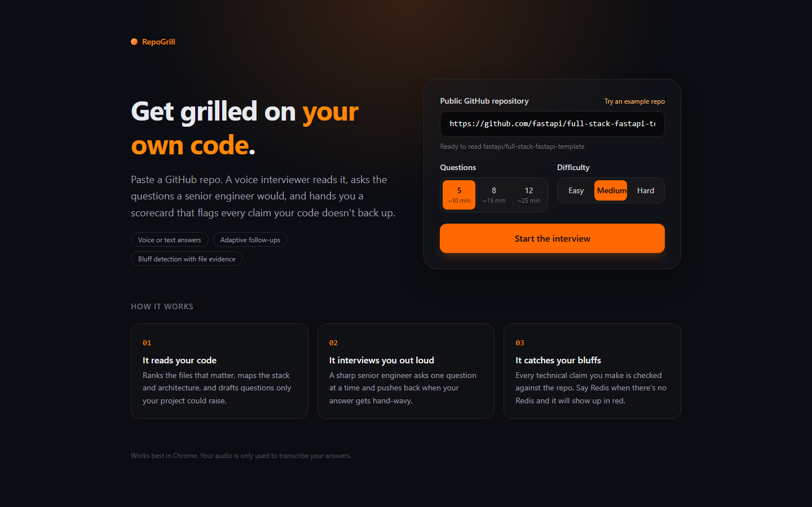
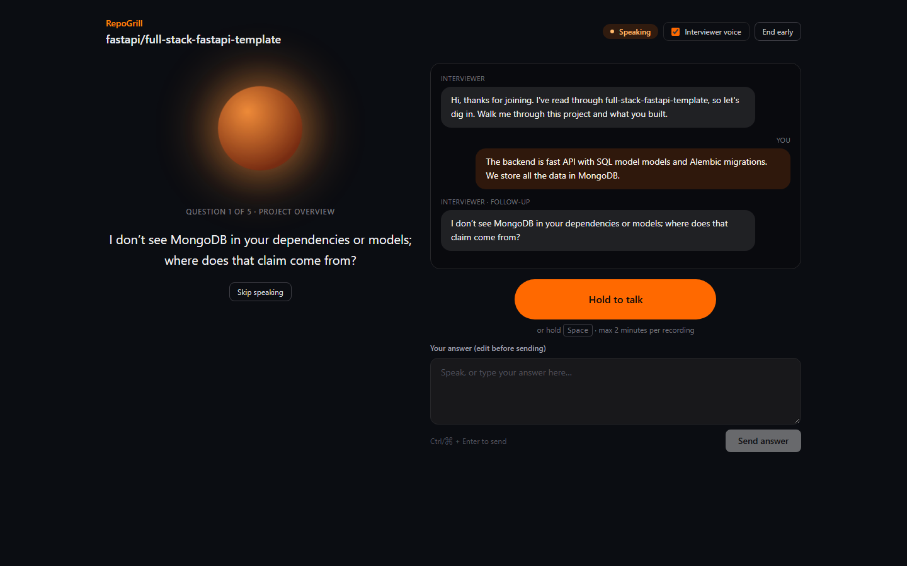
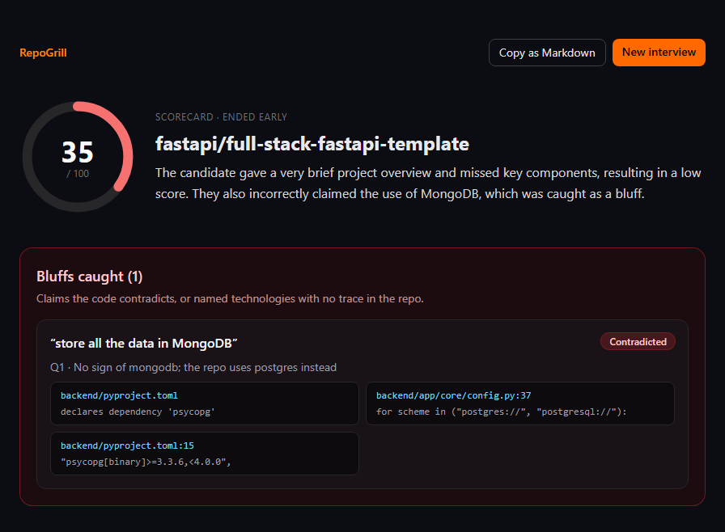
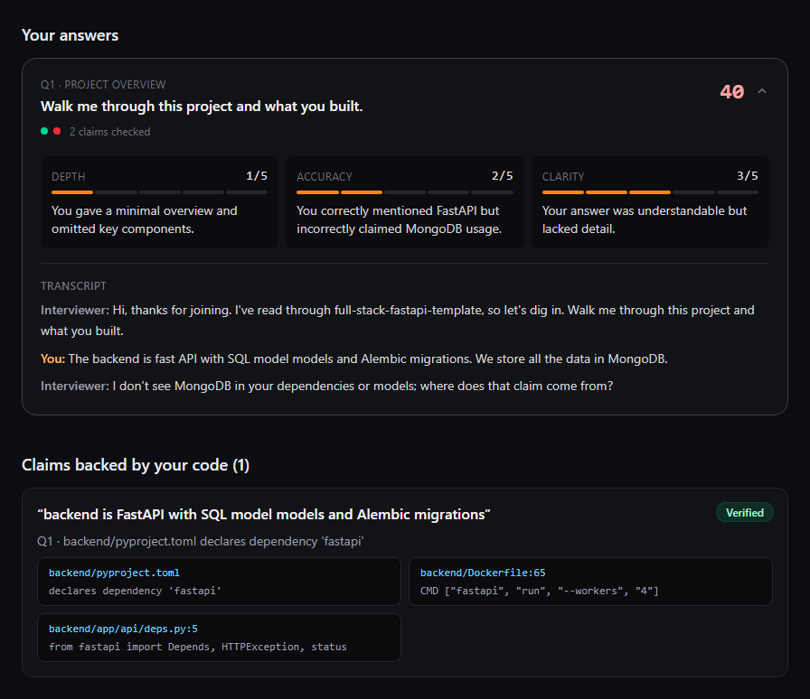
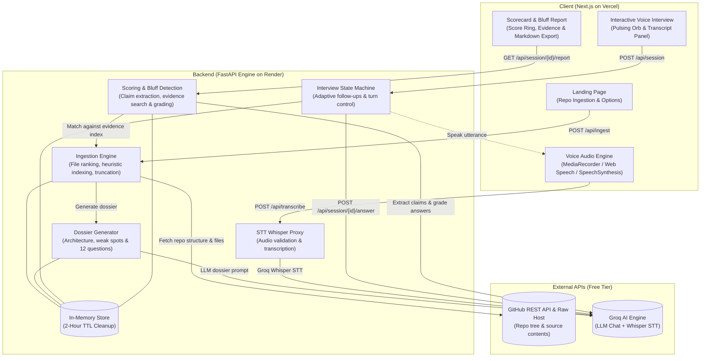
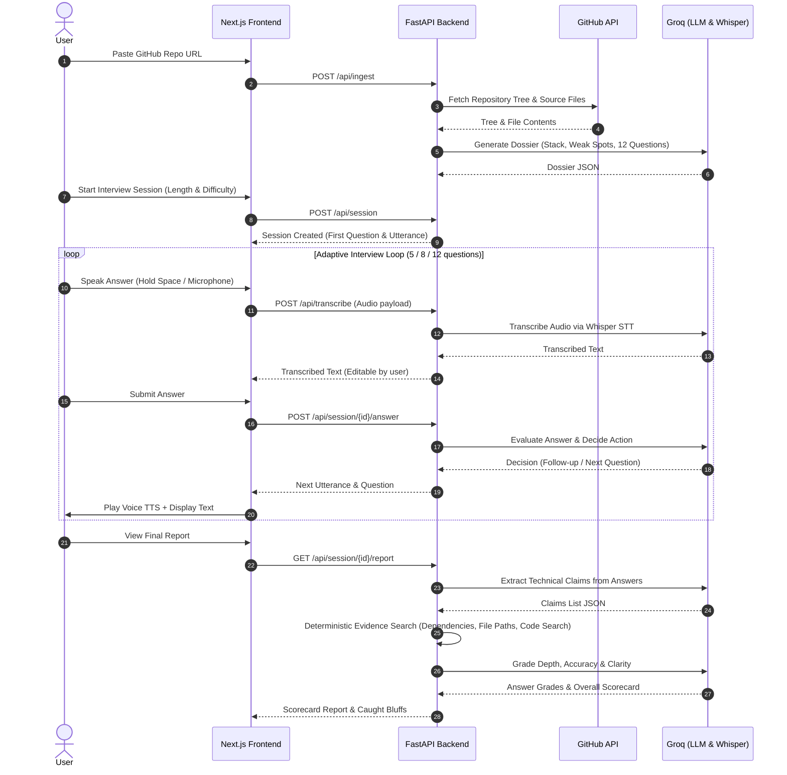

# RepoGrill

**Paste a GitHub repo. Get grilled on it, out loud, by an interviewer who has actually read your code, and see every claim you made that the code doesn't back up.**

**Live demo: [repo-grill.vercel.app](https://repo-grill.vercel.app)**

## Screenshots

| Paste a repo | Get interviewed out loud |
|---|---|
|  |  |
| **See your score and the bluffs caught** | **Per-question grades and verified claims** |
|  |  |

In this run the candidate said the project "stores all the data in MongoDB". The interviewer pushed back mid-interview, and the scorecard marked the claim **contradicted**, linking to `backend/pyproject.toml` and `config.py`, which show the project uses PostgreSQL. The true part of the answer (FastAPI, SQLModel, Alembic) was **verified** with file evidence.

## Features

- **Reads your repo.** Ranks the files that matter (README, manifests, entrypoints, core source), parses dependencies and builds a *project dossier*: stack, architecture, design decisions, weak spots and 12 tailored questions.
- **Voice interview.** Push-to-talk (button or hold <kbd>Space</kbd>), Whisper transcription you can edit before sending, and an interviewer voice through the browser's speech synthesis. If server transcription fails, the browser's own speech recognition is used instead.
- **Adaptive follow-ups.** After each answer the interviewer rates it (solid, partial, vague, contradicts the code, non-answer). It pushes back on hand-waving with specific files and components, at most twice per topic.
- **Bluff detection.** Every concrete technical claim you make is checked against the repo. The scorecard shows what was verified, what was contradicted, and named technologies that leave no trace, with links to the exact file and line at the analysed commit.
- **Scorecard.** Overall score out of 100, depth, accuracy and clarity grades for each question, strengths, and the top 5 questions to prepare with talking points grounded in your code. You can copy it all as Markdown.
- **Free tier only.** Groq (LLM and Whisper), the GitHub REST API, Render and Vercel free plans, and browser text-to-speech. No database: all state lives in memory with a 2-hour TTL.

## Architecture



### End-to-End Interview & Bluff Detection Sequence Flow



**Flow:** `POST /api/ingest` → `GET /api/dossier/{repo_id}` → `POST /api/session` → `POST /api/session/{id}/answer` (repeat) → `GET /api/session/{id}/report`. Audio goes to `POST /api/transcribe`.

### How bluff detection works

1. **Extract.** After the interview, the fast model pulls concrete claims out of each answer as JSON, e.g. `{"claim": "uses Redis for caching", "keywords": ["redis", "cache"], "kind": "technology"}`.
2. **Verify deterministically.** No LLM is involved at this step. The first keyword is looked up in order:
   - declared dependencies from `package.json`, `pyproject.toml`, `requirements*.txt`, `go.mod`, `Cargo.toml`, `Gemfile`, Maven/Gradle, `composer.json`, Dockerfiles and compose files, with aliases (e.g. `postgres` ↔ `psycopg`, `asyncpg`, `pg`)
   - file paths (e.g. `docker` → `Dockerfile`, `github actions` → `.github/workflows/`)
   - a word-bounded search of the fetched source, which records file and line
3. **Label.**
   - `verified`: found in code, config or dependencies (cited).
   - `contradicted`: not found, while a direct alternative *is* present. Claiming Postgres when only SQLite exists, or Kafka when the repo uses RabbitMQ, counts.
   - `unverified`: no evidence either way.
4. **Adjudicate only the ambiguous cases.** When the only mention is in docs, or only secondary keywords match, the LLM sees a few lines of code around each match and decides.
5. **Grade.** Claim results feed into each answer's accuracy grade. Every contradicted claim also costs 5 points off the overall score, capped at 20.

The "Bluffs caught" list contains contradicted claims plus unverified claims about named technologies.

### Staying inside free-tier limits

Groq's free tier caps each model at about 8k tokens per minute, so every call has a budget:

- The dossier prompt is packed into `DOSSIER_INPUT_TOKENS` (default 4,500). Files are ranked, and anything that doesn't fit is reduced to a *skeleton* (imports, signatures, routes).
- Interviewer calls only see the dossier summary, the current question, the last 4 turns and running notes. They never see the full transcript.
- Claim extraction and grading are batched by token budget.
- HTTP 429 and 5xx responses are retried with exponential backoff and jitter (4 attempts, honouring `Retry-After`). If the limit persists, the API returns 429 and the UI shows "Rate limited, retrying…".
- Dossiers are cached per `repo + commit SHA`. File contents come from `raw.githubusercontent.com`, which doesn't count against the GitHub API quota.
- Every LLM output is validated with pydantic. Invalid JSON gets one repair attempt, then fails gracefully.

## Local setup

**Requirements:** Python 3.11+, Node 20+, a free [Groq API key](https://console.groq.com/keys) and optionally a [GitHub token](https://github.com/settings/tokens) (no scopes needed for public repos).

### Backend

```bash
cd backend
python -m venv .venv
source .venv/bin/activate          # Windows: .venv\Scripts\activate
pip install -e ".[dev]"
cp .env.example .env               # set LLM_API_KEY (and GITHUB_TOKEN)
python scripts/discover_models.py --write
uvicorn app.main:app --reload --port 8000
```

`.env` is read from `backend/.env` and also from the repo root. `GROQ_API_KEY` is accepted as an alias for `LLM_API_KEY`.

#### Model discovery

Model names are never hard-coded. `scripts/discover_models.py` calls `GET {LLM_BASE_URL}/models`, lists everything available and suggests:

- `LLM_MODEL`: the largest chat model (dossier, interviewer, grading)
- `LLM_FAST_MODEL`: the smallest capable chat model, 14B or more (claim extraction, adjudication)
- `STT_MODEL`: a Whisper model, preferring the turbo variant

Use `--write` to save the suggestions into `backend/.env`. Any OpenAI-compatible provider works: change `LLM_BASE_URL` and `LLM_API_KEY` and run discovery again.

### Frontend

```bash
cd frontend
npm install
cp .env.example .env.local         # NEXT_PUBLIC_API_URL=http://localhost:8000
npm run dev
```

Open http://localhost:3000 in Chrome.

### Try it in the terminal

Once the backend env is configured, you can run a full text interview without the UI:

```bash
cd backend
python scripts/cli_interview.py https://github.com/owner/repo --length 5 --difficulty medium
```

Type `/end` to stop early.

### Tests and formatting

```bash
cd backend && pytest && ruff check . && black --check .
cd frontend && npm run lint && npm run typecheck && npm run format:check
```

## Environment variables

### Backend (`backend/.env`)

| Variable | Required | Default | Description |
|---|---|---|---|
| `LLM_BASE_URL` | no | `https://api.groq.com/openai/v1` | Any OpenAI-compatible API base URL |
| `LLM_API_KEY` | **yes** | | API key for the provider (`GROQ_API_KEY` also accepted) |
| `LLM_MODEL` | **yes** | | Strong chat model: dossier, interviewer, grading |
| `LLM_FAST_MODEL` | no | `LLM_MODEL` | Cheap model: claim extraction and adjudication |
| `STT_MODEL` | **yes** (for voice) | | Whisper model for transcription |
| `LLM_REASONING_EFFORT` | no | | e.g. `low` for reasoning models; omitted from requests when empty |
| `DOSSIER_INPUT_TOKENS` | no | `4500` | Prompt budget for dossier generation |
| `GITHUB_TOKEN` | recommended | | Raises the GitHub limit from 60 to 5,000 requests/hour |
| `APP_ENV` | no | `development` | `production` removes the localhost CORS origins |
| `FRONTEND_ORIGIN` | in production | | Allowed browser origin(s), comma-separated |
| `SESSION_TTL_SECONDS` | no | `7200` | Lifetime of repos, dossiers, sessions and reports in memory |
| `LOG_LEVEL` | no | `INFO` | Python log level |

### Frontend (`frontend/.env.local`)

| Variable | Required | Description |
|---|---|---|
| `NEXT_PUBLIC_API_URL` | **yes** | Base URL of the backend, e.g. `https://repogrill-api.onrender.com` |

## API

| Method | Path | Purpose |
|---|---|---|
| GET | `/api/health` | Health check |
| POST | `/api/ingest` | `{repo_url}` → `{repo_id, repo_meta, files_analyzed, dependencies}` |
| GET | `/api/dossier/{repo_id}` | Generated dossier (cached per repo + SHA) |
| POST | `/api/session` | `{repo_id, length: 5\|8\|12, difficulty: easy\|medium\|hard}` → `{session_id, first_turn}` |
| GET | `/api/session/{id}` | Transcript and current turn (for reloads) |
| POST | `/api/session/{id}/answer` | `{text}` → `{next_turn, done}` |
| POST | `/api/session/{id}/end` | End the interview early |
| POST | `/api/transcribe` | Multipart `audio` (max 2 min) → `{text}` |
| GET | `/api/session/{id}/report` | Scorecard |

## Deployment

The live instance runs on free plans only:

| Part | Host | URL |
|---|---|---|
| Frontend | Vercel (Hobby) | https://repo-grill.vercel.app |
| Backend | Render (free web service, Blueprint from `render.yaml`) | https://repogrill-api.onrender.com |

Both redeploy automatically when `main` is pushed.

### 1. Backend on Render

1. In Render, choose **New → Blueprint**, connect your GitHub account and select the repo. `render.yaml` defines the `repogrill-api` service: root dir `backend`, `pip install -r requirements.txt`, `uvicorn app.main:app`, health check `/api/health`, free plan, `APP_ENV=production`.
2. Fill in the environment variables Render asks for:

   | Key | Example value |
   |---|---|
   | `LLM_API_KEY` | your Groq API key |
   | `LLM_MODEL` | `openai/gpt-oss-120b` |
   | `LLM_FAST_MODEL` | `openai/gpt-oss-20b` |
   | `STT_MODEL` | `whisper-large-v3-turbo` |
   | `LLM_REASONING_EFFORT` | `low` |
   | `GITHUB_TOKEN` | a fine-grained token with *Public repositories (read-only)* access |
   | `FRONTEND_ORIGIN` | leave empty for now; set it in step 3 |

   Run `python scripts/discover_models.py` locally to see which model names your provider offers.
3. Deploy, then check that `https://<your-service>.onrender.com/api/health` returns `{"status":"ok"}`.

### 2. Frontend on Vercel

1. **Add New → Project**, import the repo and set **Root Directory** to `frontend`. The framework preset (Next.js) is detected automatically.
2. Add `NEXT_PUBLIC_API_URL=https://<your-service>.onrender.com`, without a trailing slash.
3. Deploy and note the domain Vercel assigns (shown under **Domains** on the project page).

### 3. Connect them

1. In Render, open the service → **Environment**.
2. Set `FRONTEND_ORIGIN` to the exact Vercel domain, e.g. `https://repo-grill.vercel.app`.
3. Choose **Save, rebuild, and deploy**.

In production the API only accepts browser requests from `FRONTEND_ORIGIN`. To allow more than one domain (e.g. a custom domain), separate them with commas.

### Troubleshooting

| Symptom | Cause and fix |
|---|---|
| Browser console shows a **CORS** error, or the interview never starts | `FRONTEND_ORIGIN` doesn't exactly match the site address. Check `https://`, hyphens and subdomains. Vercel preview URLs are different domains. |
| "GitHub API rate limit reached. It resets at …" | `GITHUB_TOKEN` is missing. Render's free instances share outbound IPs, so the anonymous 60 requests/hour runs out quickly. Add a token and redeploy. |
| "Rate limited, retrying…" | Groq's per-minute token cap was hit. It retries automatically; answering a bit more slowly avoids it. |
| "Waking the server…" for up to a minute | The free Render instance was asleep. Normal on the first visit. |
| "Interview session not found or expired" | The backend restarted (redeploy or sleep), which clears in-memory sessions. Start a new interview. |

### Free-tier limits and cold starts

- **Render free** services sleep after about 15 minutes idle. The first request can take up to a minute; the app pings `/api/health` first and shows a "Waking the server…" screen meanwhile. A restart also clears all in-memory sessions.
- **Groq free tier**: about 8k tokens per minute per model, plus daily request caps. Rapid-fire answers may briefly show "Rate limited, retrying…".
- **GitHub**: 60 requests/hour without a token, 5,000 with one. Each new repo or commit costs 3 API calls; file contents are fetched from the raw host.

## Project layout

```
backend/
  app/            FastAPI app: ingestion, dossier, interview, scoring, STT, prompts
  scripts/        discover_models.py, cli_interview.py
  tests/          pytest suite (URL parsing, ranking, evidence, retries, JSON repair, …)
frontend/
  app/            /, /interview/[id], /report/[id]
  components/     orb, composer, transcript, report widgets
  lib/            typed API client, audio helpers, hooks
render.yaml       Render blueprint for the backend
```

## License

[MIT](LICENSE)
